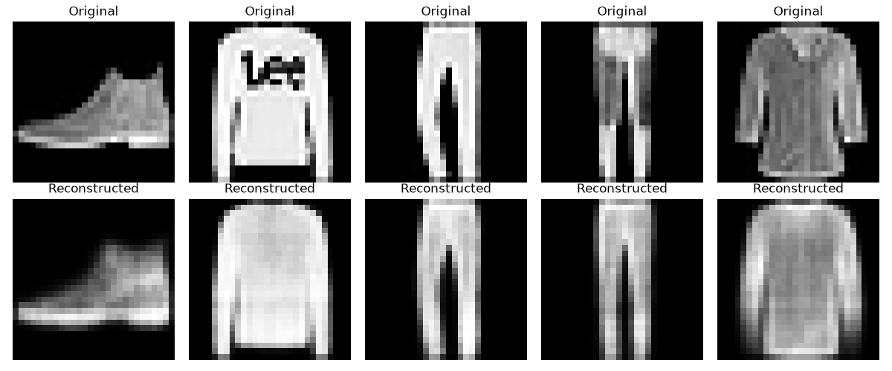

# P6: Text & Image Latent-Space Explorer

An interactive Streamlit application for exploring how text and images are represented by pretrained embedding models and a project-trained variational autoencoder (VAE). It combines semantic projections, clustering, nearest-neighbour comparisons, cross-modal visualization, and an explicitly exploratory association probe in one interface.

## Problem Statement

High-dimensional representations produced by machine-learning models are difficult to inspect directly. This project makes selected relationships visible by projecting embeddings into two dimensions and providing interactive ways to compare samples. The visualizations are intended for learning and exploration; a two-dimensional plot is not a faithful substitute for the original representation or a rigorous evaluation of a model.

## Objectives

- Encode sentences and inspect their semantic relationships.
- Compare PCA and UMAP projections and view K-Means cluster assignments.
- Inspect nearest sentences using cosine similarity in the original embedding space.
- Compare text and uploaded images in CLIP's shared embedding space.
- Explore latent codes and reconstructions from a VAE trained on Fashion-MNIST.
- Demonstrate, with clear caveats, how wording can affect occupation-related embedding similarities.

## Architecture

1. **Streamlit interface** collects text, display options, and optional image uploads.
2. **Embedding models** encode text with Sentence-BERT and encode text or images with CLIP. The VAE checkpoint encodes Fashion-MNIST images separately.
3. **Analysis** applies PCA or UMAP for text visualization, PCA for CLIP and VAE visualization, K-Means for text clusters, and cosine similarity for nearest-neighbour comparisons.
4. **Interpretation** optionally sends cluster text to Gemini for labels. When a Gemini request fails, a local TF-IDF keyword-based fallback is used.

The displayed coordinates are two-dimensional projections. Text-neighbour similarity is calculated from the original Sentence-BERT vectors, not from plotted coordinates.

## U1-U5 Implementation

| Unit | Implementation |
| --- | --- |
| **U1 - Sentence embedding and projection** | Encodes the sample and user-added sentences with `all-MiniLM-L6-v2`; displays a PCA or UMAP projection with category or cluster coloring. |
| **U2 - Clustering and similarity exploration** | Runs K-Means on the original sentence embeddings. Selecting a plotted sentence displays up to five nearest neighbours ranked by cosine similarity. |
| **U3 - Cluster interpretation** | Requests concise cluster labels from Gemini when a key is configured; uses local TF-IDF keywords if a request fails. |
| **U4 - Image and latent-space exploration** | Uses CLIP (`openai/clip-vit-base-patch32`) to project text and uploaded images together. A separate VAE view projects Fashion-MNIST encodings and decodes a selected point. |
| **U5 - Association probe** | Compares Sentence-BERT cosine similarities for neutral, man-referenced, and woman-referenced occupation templates. It is an exploratory prompt/model probe, not a measure of societal bias or a decision tool. |

## Technologies

- Python and Streamlit
- Sentence-Transformers (`all-MiniLM-L6-v2`)
- Hugging Face Transformers CLIP (`openai/clip-vit-base-patch32`)
- PyTorch and torchvision for the VAE and Fashion-MNIST
- scikit-learn (PCA, K-Means, cosine similarity, TF-IDF)
- UMAP, NumPy, Pandas, Plotly, and Matplotlib
- Google GenAI SDK for optional Gemini cluster descriptions

## Installation

Use Python 3.10 or later. From the project directory, create and activate an environment, then install the dependencies:

```powershell
conda create -n latent-space-explorer python=3.12
conda activate latent-space-explorer
python -m pip install -r requirements.txt
```

PyTorch installation can differ by operating system and accelerator. For a CUDA-specific setup, install the matching PyTorch and torchvision builds using the official PyTorch installation selector, then install the remaining project dependencies.

The VAE checkpoint, `fashion_vae.pth`, is included. On first use, the application downloads the Sentence-BERT and CLIP model files from Hugging Face. The VAE explorer downloads the Fashion-MNIST test split through torchvision; dataset files are not included in this repository.

### Optional Gemini setup

Gemini cluster naming requires a Google Gemini API key. Create `.streamlit/secrets.toml` locally with:

```toml
GEMINI_API_KEY = "your-api-key"
```

This file is ignored by Git. Never commit API keys. Without a configured key, the app reports that Gemini is unavailable; the TF-IDF fallback is used when a Gemini request is attempted and fails.

## Run

Start the application from the project directory:

```powershell
streamlit run app.py
```

Streamlit prints a local URL (normally `http://localhost:8501`). Model downloads and the first VAE dataset download require network access. The Gemini feature additionally requires its optional API key.

## Results

The repository includes an existing VAE reconstruction output. It is a model result figure, not a screenshot of the Streamlit interface.



The app also produces interactive sentence, CLIP, VAE, and association-probe plots. The projections are qualitative views; inspect the original text, model, and similarity values before drawing conclusions.

## Training and Checks

- `python train_vae.py` trains the VAE for five epochs on Fashion-MNIST and writes `fashion_vae.pth`. Running it replaces the included checkpoint.
- `python test_vae.py` runs a reconstruction example and writes `vae_reconstruction.png`, replacing the existing figure.
- `streamlit run test_streamlit.py` displays a lightweight dependency-import check.

## Repository Contents

- `app.py` - Streamlit application
- `vae_model.py`, `train_vae.py`, `test_vae.py` - VAE definition and scripts
- `test_streamlit.py` - dependency-import check
- `fashion_vae.pth` - trained VAE state dictionary used by the app
- `vae_reconstruction.png` - existing reconstruction result
- `MODEL_CARD.md` - model details, limitations, and responsible-use notes

Fashion-MNIST source data, local secrets, environment files, caches, and editor-specific settings are excluded from Git.
